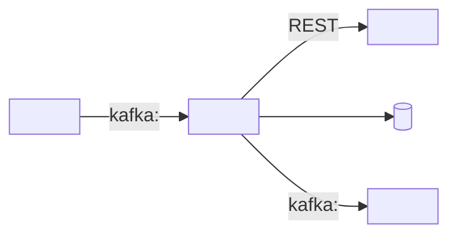

# Documentation templates

Copy, fill from discovered facts, delete guidance lines. Keep `<!-- source: … -->` comments.

## README.md

````markdown
# <service-name>

<One paragraph: what it does, for whom, why it exists.>

| | |
|---|---|
| Team | <team> · Slack `#<channel>` |
| Tier / SLO | <P0–P3> · <99.9% availability / 28d> |
| Stack | Java 25 · Spring Boot 4.x · <Gradle|Maven> |
| Deploy | Olympus (Argo CD) — see [deployment](docs/deployment.md) |
| Dashboards | [STG](<link>) · [PRD](<link>) — see [observability](docs/observability.md) |
| Runbook | [docs/runbook.md](docs/runbook.md) |

## Quick start

```bash
./gradlew bootRun          # or ./mvnw spring-boot:run
curl localhost:8081/actuator/health
```

Requires: <Docker for Testcontainers, local Kafka via compose, …>

## Build and test

```bash
./gradlew check            # or ./mvnw verify
```

## Documentation

- [Architecture](docs/architecture.md)
- [Dependencies](docs/dependencies.md)
- [Deployment (Argo CD)](docs/deployment.md)
- [Observability (Grafana)](docs/observability.md)
- [Configuration](docs/configuration.md)
- [Runbook](docs/runbook.md)
- [ADRs](docs/adr/)
````

## docs/architecture.md

````markdown
# Architecture



## Components
| Package | Responsibility |
|---------|----------------|

## Main flows
1. <flow name>: <step> → <step> → <step>
````

## docs/dependencies.md

```markdown
# Dependencies

_Last verified: YYYY-MM-DD_

## Upstream (calls / produces to us)
| Service | Interface | Topic / endpoint | Owner | Impact if down |
|---------|-----------|------------------|-------|----------------|

## Downstream (we call / produce to)
| Service | Interface | Topic / endpoint | Config property | Timeout / retry | Owner | Impact if down | Health signal |
|---------|-----------|------------------|-----------------|-----------------|-------|----------------|---------------|

## Data stores
| Store | Type | Name / schema | Migrations | Owner |
|-------|------|---------------|------------|-------|

## Kafka
| Topic | Direction | Consumer group | Key | Schema / DTO | DLT |
|-------|-----------|----------------|-----|--------------|-----|

## Secrets (names only)
| ExternalSecret | AWS Secrets Manager path | Keys | Used for |
|----------------|--------------------------|------|----------|
```

## docs/deployment.md

```markdown
# Deployment

Platform: Olympus (EKS + Argo CD). Infra repo: [<repo>-infra](https://github.com/Flutter-Global/<repo>-infra).
_Last verified: YYYY-MM-DD_

## Argo CD applications
| Env | Argo CD app | Cluster | Namespace | Chart / image version | Replicas | Ingress host | Link |
|-----|-------------|---------|-----------|-----------------------|----------|--------------|------|
| dts | | gst-stg-euw1-app-1 | <app>-stg | | | | [Argo CD](https://argocd.grt.dts.euw1.int.fluttergroup.com/applications/<app>) |
| prd | | gst-prd-euw1-app-1 | <app>-prd | | | | [Argo CD](https://argocd.grt.prd.euw1.int.fluttergroup.com/applications/<app>) |

## Pipeline
<CI workflow names> → Forge Store (jar / image / Helm chart) → `notify-infrastructure-repo` → infra PR → Argo CD sync.

## Promotion
<how a version moves dts → nxt → prd: which workflow / PR, who approves>

## Rollback
1. **Revert the version** in `<repo>-infra/environments/<env>/` (PR) — preferred, keeps GitOps state true.
2. Emergency: `argocd app rollback <app> <history-id>` (then fix Git, or Argo CD will re-sync).
3. DB migrations: <forward-only / how to undo>.

## Configuration per env
`<repo>-infra/variants/<env>/values/values.yaml` — see [configuration](configuration.md).
```

## docs/observability.md

```markdown
# Observability

_Last verified: YYYY-MM-DD_

## Dashboards
| Dashboard | Purpose | STG | PRD | Source |
|-----------|---------|-----|-----|--------|
| <title> | golden signals, JVM, deps, logs | [link](https://ppbtradingtribe.grafana.net/d/<uid>) | [link](https://ppbtradingtribeprd.grafana.net/d/<uid>) | `observability/dashboards/<file>.json` |

## Alerts
| Alert | Severity | Condition | For | Routes to | Runbook |
|-------|----------|-----------|-----|-----------|---------|
| | | | | | [section](runbook.md#high-5xx-errors) |

## SLOs
| SLI | Target | Window | Burn-rate alerts |
|-----|--------|--------|------------------|

## Key queries
<copied from the grafana-observability skill, with this service's namespace>

## Logs and traces
- Loki: `{cluster="<cluster>", namespace="<ns>"}` — <JSON | plain text>
- Traces: <Tempo service name | not exported yet>

## Known gaps
| Gap | Impact | Tracking |
|-----|--------|----------|
```

## docs/configuration.md

```markdown
# Configuration

| Property / env var | Purpose | Default | dts | prd | Secret? |
|--------------------|---------|---------|-----|-----|---------|
```

## docs/runbook.md

Follows **Flutter "4.4 Service Runbook Standard and Template"**. Headings are stable anchors — Grafana alert
`runbook_url` annotations deep-link to them (`.../docs/runbook.md#high-5xx-errors`).

````markdown
# <service-name> runbook

_Owner: <team> · Last reviewed: YYYY-MM-DD_

## Service overview
- **What it does:** <one paragraph>
- **Tier / priority:** <P0–P3> — <impact of downtime>
- **SLO:** <target> — [SLO dashboard](<link>)

## Ownership and escalation
- **Team:** <team>
- **Pager policy:** <PagerDuty service/link>
- **Slack:** `#<team-alerts>` (alerts) · `#<team>` (discussion)
- **Escalation:** <secondary on-call / tech lead>
- **Declare an incident:** [4.5 Incident Response and Communication](https://fluttergroup.atlassian.net/wiki/spaces/FGSC/pages/4295218856206)

## Monitors and alerts
| Alert | Triggers when | Action |
|-------|---------------|--------|
| **High 5xx ratio** | 5xx ratio > 5% for 5m | See [High 5xx errors](#high-5xx-errors) |
| **Slow requests** | latency > <X> for 10m | See [High latency](#high-latency) |
| **Pod restarting** | > 2 restarts in 15m | See [Pod restarts](#pod-restarts) |

## Dashboards
- Service: [STG](<link>) · [PRD](<link>)

## Troubleshooting

### Verify service health
1. **Open the service dashboard** — error spikes, latency, memory vs limit, restarts.
2. **Check Argo CD** — app Synced/Healthy, recent sync = recent deploy?
3. **Check logs** — `{cluster="<cluster>", namespace="<ns>"} | detected_level=~"error|warn"`.

### High 5xx errors
1. **Find the failing URI and exception** — RPS by `uri`/`status`, logs around the spike.
2. **Dependency failing?** → [Dependency issues](#dependency-issues).
3. **Recent deploy?** → [Rollback](#rollback) and observe.

### High latency
1. **Check saturation** — CPU throttling, memory, Hikari pending.
2. **Check downstream latency** — client metrics / traces.
3. **Scale** → [Scaling](#scaling).

### Pod restarts
1. **Find the reason** — `kube_pod_container_status_last_terminated_reason` (OOMKilled?), previous logs.
2. **OOMKilled** → raise memory limit / check heap settings; **probe failures** → readiness/liveness config.

### Dependency issues
| Dependency | Health signal | Owner / channel |
|------------|---------------|-----------------|

## Common procedures

### Scaling
<replicas in `variants/<env>/values/values.yaml`; HPA policy if any; who may do it>

### Rollback
<from docs/deployment.md — revert infra PR; emergency `argocd app rollback`>

## Quick reference
- Repo: <link> · Infra repo: <link>
- Argo CD: [dts](<link>) · [prd](<link>)
- Grafana: [STG](<link>) · [PRD](<link>)
- Logs: [Loki Explore](<link>)

## Architecture and infrastructure
- Kubernetes deployment `<name>` in `<cluster>` / `<namespace>`; <N> pods in prd
- Dependencies: see [dependencies](dependencies.md)

## Footnotes
- PIRs / historical incidents: <links>

## Review checklist
- [ ] Owner named, reviewed ≤ 6 months ago
- [ ] Every paging alert links to a section here
- [ ] Rollback tested in the last quarter
- [ ] All links work
- [ ] On-call and Support have access
````

## docs/adr/NNNN-title.md

```markdown
# NNNN. <Decision title>

- Status: proposed | accepted | superseded by NNNN
- Date: YYYY-MM-DD

## Context
## Decision
## Consequences
```
